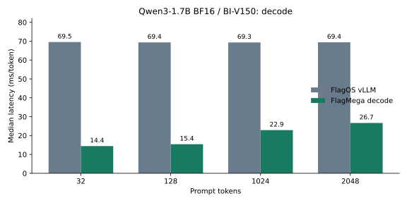
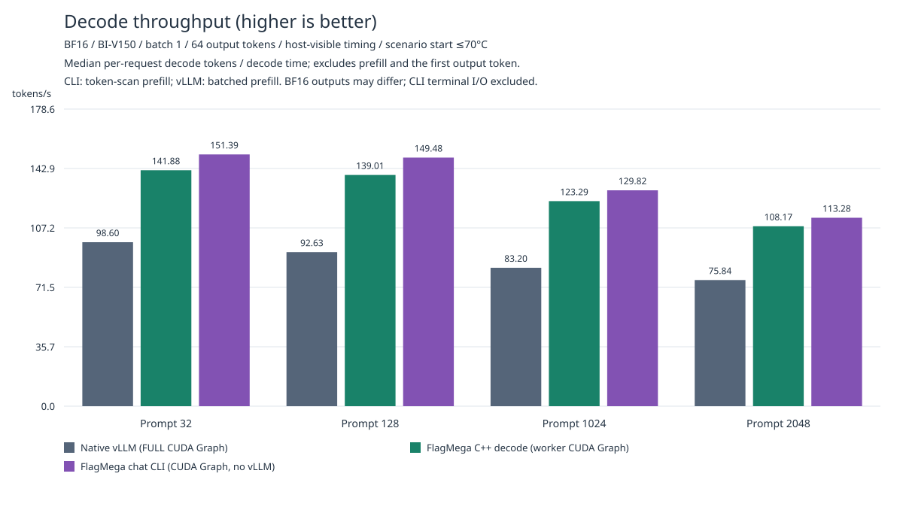
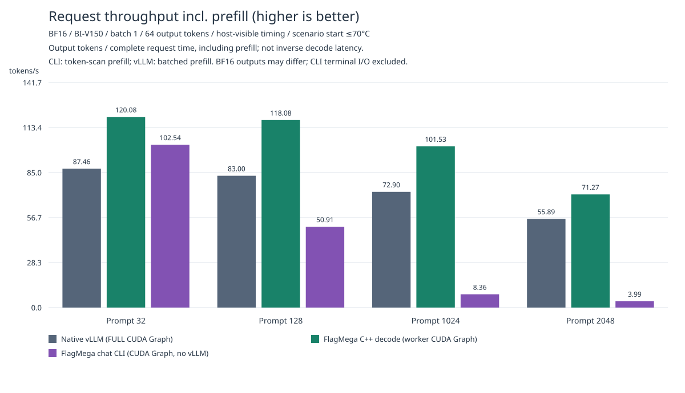

# Qwen3-1.7B BF16 / Iluvatar BI-V150

This tutorial uses FlagMega to compile decode for the complete 28-layer Qwen3-1.7B
model on **one BI-V150 GPU**. The reference implementation is
**vLLM 0.24.0 with the FlagOS/FlagGems plugin**. vLLM handles native prefill,
scheduling, page allocation and sampling; FlagMega executes the complete model
at each decode step. The 4×4 mesh represents 16 CTAs on one GPU.

## Environment and correctness prerequisites

The validated environment uses COREX 4.5.0.20260509,
PyTorch 2.10.0+corex.4.5.0.20260509 and Python 3.12. Use the editable FlagTree
installation from this checkout. Upstream NVIDIA Triton or PyTorch packages
cannot replace the COREX-compatible packages. The source revisions are:

| Component | Commit |
|---|---|
| vLLM | `ee0da84ab9e04ac7610e28580af62c365e898389` |
| vllm-plugin-FL | `ce3a43b28423bad54f832bf3b8a347a47244bcea` |
| FlagGems | `b550ddb996939ee1a30ba4a4b8f8b2d0556703a3`, with the patch below |
| Qwen3-1.7B checkpoint | `70d244cc86ccca08cf5af4e1e306ecf908b1ad5e` |

The Iluvatar compiler in this checkout includes two required correctness fixes:

- The grid barrier reports CTA arrival only after all producer threads complete
  their device fences, ensuring data visibility across SMs.
- The MMA reduction loop optimization preserves the per-iteration scaling of
  the accumulator's initial value.

After compiler changes, rebuild the native extension with the repository-local
`./build-iluvator.sh` script. For the FlagGems revision above, apply
[patches/flaggems-correctness.patch](patches/flaggems-correctness.patch) if those
fixes are absent:

```bash
git -C /path/to/FlagGems apply --check "$TUTORIAL/patches/flaggems-correctness.patch"
git -C /path/to/FlagGems apply "$TUTORIAL/patches/flaggems-correctness.patch"
```

The patch fixes empty unique and a cross-warp partner-read race in in-place RoPE.
Do not apply it again to a checkout with equivalent fixes. Both implementations
must use the same corrected dependencies. The existing deployment also retains
the COREX implementations of `sort,sort_stable`, with identical configuration
for both variants.

## Reproduce from the original model

Run these commands from the FlagTree repository root. `vllm-iluvatar` is the
prepared local FlagOS environment; other machines need equivalent dependencies.
Use `ixsmi` to select an idle GPU first.

```bash
source /root/miniconda3/etc/profile.d/conda.sh
conda activate vllm-iluvatar
export TUTORIAL="$PWD/python/tutorials/flagmega/01-qwen3-1.7b-bf16/iluvator-bi-v150"
export CHECKPOINT=/root/models/Qwen3-1.7B
export CUDA_VISIBLE_DEVICES=10
export CUDA_MODULE_LOADING=0
export PYTHONPATH="$TUTORIAL${PYTHONPATH:+:$PYTHONPATH}"

python "$TUTORIAL/reproduce_flagos.py" \
  --checkpoint "$CHECKPOINT" \
  --work-dir "$TUTORIAL/.local/fresh-build" \
  --results "$TUTORIAL/.local/fresh-results" \
  --rounds 3 --repeats 3
```

Use fresh work and results directories. This command builds the strict FlagOS
numerical profile from the checkpoint, verifies the artifact, then compares
native→FlagMega, FlagMega→native and native→FlagMega in three alternating rounds.
Each round rotates the scenario order and runs one warmup and three measured
requests per scenario. Every complete greedy token sequence, including warmups,
must match the native reference; any failure blocks result publication. Native
GPU compilation and weight loading are excluded from request timing.

For an existing verified artifact, replace `--work-dir` with
`--artifact /path/to/serving/artifact`. The artifact must contain `final.py`,
a manifest, rdata and generated source. C++ artifacts also require the generated
shared library. Generated source alone contains no weights and cannot replace
the complete artifact.

To compile the model without benchmarking:

```bash
python "$TUTORIAL/optimize.py" --checkpoint "$CHECKPOINT" \
  --work-dir "$TUTORIAL/.local/model-build" --profile serving \
  --numerical-profile vllm-flagos-eager-bf16
python -m triton.flagmega artifact verify "$TUTORIAL/.local/model-build/serving/artifact"
```

The FlagOS profile explicitly preserves BF16 rounding before weight multiplication
in standalone RMSNorm, FP32 normalization for fused residuals, and the BF16
boundaries at matmul outputs and after QKV merging. Changing the numerical profile
requires recompilation from the original checkpoint; a normal resume from later
IR does not reselect distributions or TIR. `optimize.py` still supports the
historical `vllm-493bd8323-inductor-level3` profile, but the FlagOS results here
use the profile above.

## Measurement boundaries and optimizations

The configuration fixes BF16, batch/concurrency=1, a maximum context of 3072,
256-token KV pages and 16 pages. Prefix caching is disabled for both variants.
Independent requests use 32/128/1024/2048-token prompts and generate 64 tokens
each. The reproduction script defaults to an eager baseline; the updated charts
below explicitly use native vLLM FULL CUDA Graph. Timing includes scheduling,
forward execution, sampling and output processing. Decode, TTFT, complete request
latency and P95 are reported separately. Device kernel time alone does not
represent request latency.

### Native FlagOS CUDA Graph baseline

vLLM 0.24.0 with the FlagOS plugin does not use the `VLLM_ENFORCE_CUDA_GRAPH`
environment variable from older vendor images. The benchmark explicitly sets
`mode=0` to avoid the currently incompatible Inductor path,
`cudagraph_mode=FULL`, `cudagraph_capture_sizes=[1]` and `enforce_eager=False`
for the native FlagOS variant. The FlagMega worker extension is installed after
initialization, so the outer vLLM execution remains eager while decode runs
through the adapter's CUDA Graph. That graph includes token, seq_len and page
table updates together with the complete C++ megakernel. Both variants retain
the same native prefill, scheduling and sampling.

The following comparison was measured on 2026-09-29 with the same BI-V150 and
Qwen3-1.7B checkpoint: one warmup, three measured requests and 64 output tokens
per request. Complete raw JSON reports and logs are retained in
`.local/perf-iteration/flagos-cuda-graph-20260929/`.

| prompt tokens | eager decode median | CUDA Graph decode median | decode speedup | eager request median | CUDA Graph request median |
|---:|---:|---:|---:|---:|---:|
| 32 | 68.824 ms | 11.822 ms | 5.82× | 4422.8 ms | 751.8 ms |
| 128 | 68.233 ms | 11.841 ms | 5.76× | 4386.4 ms | 763.7 ms |
| 1024 | 69.192 ms | 12.538 ms | 5.52× | 4443.7 ms | 828.4 ms |
| 2048 | 68.931 ms | 13.124 ms | 5.25× | 4517.1 ms | 1038.9 ms |

The CUDA Graph startup logs contain
`Capturing CUDA graphs (mixed prefill-decode, FULL)`. Complete greedy token
sequences for all four prompts match the eager reference. This validates the
native FlagOS graph path on BI-V150. The C++ integration validation from
2026-10-21 and the current charts are described below.

Workload-specific choices are implemented in
[local_optimizations/](local_optimizations/):

- Select an MLP down-projection tile that uses the available threads, eliminating
  the many serial reductions caused by the original 8×16 tile.
- Read QKV in the packed weights' physical order, accumulate in FP32 and preserve
  the final output rounding.
- Use `block_k=64` and 32 warps for QKV GEMV on BI-V150 to reduce CTA synchronization
  during K reduction. Other GEMVs retain their validated large-tile configurations.
- Use the logits-only serving ABI, with vLLM handling sampling.

[flagos_adapter.py](flagos_adapter.py) installs through the vLLM worker extension
API. Native TRITON_ATTN KV reads and writes accept runtime strides, allowing
per-layer views of shared `[page, layer, KV, token, head, dimension]` storage.
Decode executes without KV copies or reference-model forward calls and does
not select the native model based on generated results.

## C++ backend

The C++ backend uses the COREX compiler to generate the complete decode
megakernel. On the current BI-V150, the default SME weight pipeline uses FIFO
counter waits; each lane completes its shared-memory reads before the slot is
reused. After loading and validation, GLU/down read-only weights are arranged
in device memory by CTA shard. The original IR, artifact assets and source-layout
program remain canonical. Device reordering is excluded from steady-state
decode timing. SME selection checks the physical layout, address alignment and
shared-memory budget, while QKV and shared-memory reuse retain the required
synchronization.

For an existing `bufferized_tir`, the Python API can create a separate C++
artifact:

```python
from triton.flagmega.artifacts import write_artifact
from triton.flagmega.importer import DirectoryCheckpoint
from triton.flagmega.ir import load_module

write_artifact(
    load_module("/path/to/final.py"),
    "/path/to/new-cpp-artifact",
    target="iluvatar-bi-v150",
    checkpoint=DirectoryCheckpoint("/path/to/Qwen3-1.7B"),
    emit_executable=True,
    codegen_backend="cpp",
)
```

Measurements on GPU 8 with the same model on 2026-10-20 showed net bandwidth
utilization of 80.0115%–80.0878% across five matmul families: GLU, down, QKV,
attention output and logits. This diagnostic uses a fixed 819 GB/s denominator
and subtracts the shell time from each isolated family measurement in the same
round. At context=1, standalone CUDA Graph execution took approximately
6.39–6.40 ms/token, measured as `append + synchronize`. It includes C++ logits
and greedy argmax, while vLLM scheduling and output processing are excluded.
Its timing boundary differs from the complete vLLM decode intervals below.
All 151936 logits across 600 steps matched the original C++ numerical reference
bit-for-bit. Iterations, rejected candidates, failing regressions and raw log
locations are recorded in the
[local iteration notes (Chinese)](.local/perf-iteration/cpp-backend-iteration.zh.md).

## Standalone chat CLI

```bash
python -m triton.flagmega.serving.chat_cli \
  --artifact "$TUTORIAL/.local/model-build/serving/artifact" \
  --checkpoint "$CHECKPOINT" --ctx-size 3072 --n-predict 64 \
  --chat-template-kwargs '{"enable_thinking": false}' --prompt 'Introduce yourself in one sentence.'
```

The standalone CLI runs both prefill and decode through the same complete C++
artifact, without importing vLLM. Its measurements appear in the three charts
below. Timing includes graph execution, greedy sampling, host token delivery and
incremental text decoding. Model loading, warmup, terminal output and user input
wait are excluded. The CLI's token-scan prefill and vLLM's batched prefill have
different TTFT and complete request costs.

For the same raw token prompt, native batched prefill and the CLI produce
different first tokens. Configuring the same native FlagOS vLLM with
`max_num_batched_tokens=1` produces the same sequence as the CLI's token-scan
path. This independent native reference is used only for correctness checks;
the vLLM performance charts still use FULL graph with batched prefill.
Changing native prefill chunking alone reproduces the output difference, but
the responsible native operator has not been isolated. Token-scan and batched
prefill therefore cannot be claimed to produce bit-identical outputs.
The old and new C++ artifacts, in eager and graph modes, produce bit-identical
full-vocabulary logits after the 32-token prompt. See the
[CLI measurement records](figures/data/chat-cli/README.md) for evidence and
reproduction details.

Collect the native token-scan reference in `vllm-iluvatar`, then measure the CLI
in `flagtree`:

```bash
python "$TUTORIAL/check_chat_cli_reference.py" --checkpoint "$CHECKPOINT" \
  --output /tmp/chat-native-reference.json
conda activate flagtree
python "$TUTORIAL/benchmark_chat_cli.py" --checkpoint "$CHECKPOINT" \
  --artifact /path/to/final/artifact --native-reference /tmp/chat-native-reference.json \
  --results /tmp/chat-results --rounds 1 --round-offset 0 --repeats 5 --warmups 1 \
  --max-start-temperature 70 --cuda-graph
```

## Charts and CUDA Graph comparison

Collect all three variants serially from `vllm-iluvatar`; the CLI subprocess
uses the separate `flagtree` environment:

```bash
CUDA_VISIBLE_DEVICES=8 python "$TUTORIAL/reproduce_flagos.py" \
  --checkpoint "$CHECKPOINT" --artifact /path/to/final/artifact \
  --results /tmp/three-way-results --rounds 3 --repeats 5 --cuda-graph \
  --max-start-temperature 70 \
  --chat-python /root/miniconda3/envs/flagtree/bin/python \
  --chat-native-reference /tmp/chat-native-reference.json \
  --figure-dir "$TUTORIAL/figures"
```

The current [figures/](figures/) compare native vLLM FULL CUDA Graph,
FlagMega-vLLM integration and standalone chat CLI using the same final C++
artifact on GPU 8. The charts follow the 1200×690 grouped bars, colors and metric
definitions in the [H800 figures](../nvidia-h800/figures/):
32/128/1024/2048-token inputs, 64 output tokens per request,
batch/concurrency=1 and prefix caching disabled. Measurements here were collected
on BI-V150; H800 measurements remain in their own directory.

The three rounds rotate serially through native→FlagMega→CLI,
FlagMega→CLI→native and CLI→native→FlagMega. Each variant uses a fresh process
per round and rotates the scenario order. Before each scenario, the GPU cools
to at most 70°C outside request timing, followed by one warmup and five measured
requests. Starting temperature and clocks are recorded. Initialization, weight
loading, read-only weight reordering and graph capture are excluded from
steady-state timing. Every warmup and measured vLLM integration request matches
the native batched-prefill reference. Each C++ integration process captures one
graph and replays it for every decode step, sharing native prefill KV storage
without cache copies.







| prompt tokens | vLLM FULL graph decode | C++ worker graph decode | decode speedup | request speedup |
|---:|---:|---:|---:|---:|
| 32 | 11.812 ms | 7.231 ms | 1.63× | 1.37× |
| 128 | 11.901 ms | 7.300 ms | 1.63× | 1.42× |
| 1024 | 12.798 ms | 8.301 ms | 1.54× | 1.39× |
| 2048 | 13.630 ms | 9.444 ms | 1.44× | 1.28× |

| prompt tokens | vLLM decode tokens/s | C++ decode tokens/s | vLLM request tokens/s | C++ request tokens/s |
|---:|---:|---:|---:|---:|
| 32 | 98.60 | 141.88 | 87.46 | 120.08 |
| 128 | 92.63 | 139.01 | 83.00 | 118.08 |
| 1024 | 83.20 | 123.29 | 72.90 | 101.53 |
| 2048 | 75.84 | 108.17 | 55.89 | 71.27 |

The standalone chat CLI uses 15 independent measured requests per input length
across three rounds. All three implementations use the same process lifecycle
and scenario start-temperature conditions.

| prompt tokens | CLI decode median | P95 | decode tokens/s | request tokens/s | prefill | TTFT |
|---:|---:|---:|---:|---:|---:|---:|
| 32 | 6.585 ms | 6.640 ms | 151.39 | 102.54 | 207.9 ms | 208.0 ms |
| 128 | 6.688 ms | 6.712 ms | 149.48 | 50.91 | 835.7 ms | 836.0 ms |
| 1024 | 7.704 ms | 7.732 ms | 129.82 | 8.36 | 7167.5 ms | 7168.0 ms |
| 2048 | 8.825 ms | 8.930 ms | 113.28 | 3.99 | 15488.1 ms | 15488.6 ms |

CLI decode includes per-step sampling, synchronization, host token delivery and
text decoding. All 4608 output tokens from 72 warmup and measured requests match
the native token-scan reference. Warmups for all four scenarios in every round
are retained, and all measured samples contribute to the aggregate.
The thermal drift observed during earlier continuous long prefill is retained
as a separate diagnostic; see the
[measurement audit (Chinese)](figures/data/chat-cli/measurement-audit.zh.md).
CLI outputs differ from the batched-prefill outputs in the charts, and its
long-input token-scan prefill significantly increases complete request time.
Decode latency ratios therefore do not establish an end-to-end speedup for
identical output sequences.

The vLLM integration improves both decode and complete request latency over
native FULL graph for all four context lengths. The average of the two
short-context decode speedup ratios is approximately 1.63×; the ratios for
1024/2048 are approximately 1.54×/1.44×, with gaps of about 5.5%/11.6% relative
to the short-context average. Complete C++ step time at 2048 fell from
19.881 ms before optimization to 9.444 ms, including scheduling and sampling.
The 80% net bandwidth utilization across five matmul families is an independent
diagnostic and is not used to derive request speedups.

The main long-context bottleneck was the serial head loop and repeated KV
reads in C++ attention. `_select_attention_staging` checks the single-query
configuration, contiguous BF16 KV storage, GQA=2, head sharding and shared-memory
budget. It selects four concurrent heads, cooperative GQA-pair loading of each
KV block once, 64-token load blocks and a padded shared-memory layout. The
invariant query stays in registers to avoid reloading it for each KV block.
Four 16-token online softmax updates and ordered probability/value reductions
preserve the original computation order; critical accumulations use explicit
FMA. Two alternating value buffers reduce synchronization. Actual temporary
storage is 116992 bytes within the existing 128 KiB arena. See the
[attention root-cause records (Chinese)](figures/data/attention-root-cause.zh.md)
for numerical analysis, rejected candidates and regression evidence.

Decode latency is the median of all `63 × 15` host-visible decode intervals,
excluding the first output token. Decode throughput is the median of per-request
`63 / total decode time`; request throughput is the median of
`64 / complete request time`, including prefill. Throughput is not computed as
the reciprocal of the median decode latency.

A 32-token prompt decodes at context lengths of approximately 33–95 tokens.
The historical approximately 6.4 ms measurement times the complete standalone
C++ model as `append + synchronize`. The approximately 10 ms measurement before
input preparation fusion times the complete vLLM step. After the long-context
optimization, current short-request decode steps take approximately 7.2 ms.
Graph and outside-graph diagnostics use means; the formal charts use medians
of host-visible decode intervals. These measurement boundaries are recorded
separately.

Input preparation for single-request decode is now fused. The root cause was
native `ModelRunnerFL._prepare_inputs`, which uploaded several small tensors
for one query and separately executed index, cast, add, copy and slot-mapping
operations, taking approximately 2.51 ms/step of CPU submission time.
[decode_inputs.py](decode_inputs.py) packs the position, token source, discard
flag and latest physical page table into one pinned CPU buffer, uploads it once
asynchronously, then writes the native GPU buffers with one kernel. Submission
time falls to approximately 0.14 ms. The native scheduler still allocates pages
at every step, and asynchronous tokens still come from the native sampler's GPU
output. Consecutive requests and page transitions do not assume contiguous
physical pages. vLLM's existing input-preparation event protects pinned-buffer
reuse.

The following same-GPU diagnostic uses a 32-token prompt, three requests and
189 decode steps per implementation. The decomposition uses **means**, unlike
the medians in the formal charts:

| Timing component | Native vLLM FULL graph | Final C++ worker graph |
|---|---:|---:|
| Complete engine.step | 10.606 ms | 7.228 ms |
| Graph device execution | 7.355 ms | 6.107 ms |
| Outside-graph residual | 3.252 ms | 1.121 ms |
| Outside-graph vocabulary projection | 0.957 ms | Included in graph |
| Residual after subtracting model computation | 2.294 ms | 1.121 ms |

Native FULL graph returns hidden states and executes the LM head outside the
graph; the C++ graph includes logits. The native outside-graph residual in this
diagnostic is approximately 3.25 ms, compared with 3.34 ms in the historical
same-GPU diagnostic, with approximately 0.96 ms attributable to the LM head.
The residual is host elapsed time minus device computation and includes CPU/GPU
overlap, sampling, transfers and output processing. It is not an isolated
measurement of pure CPU time. Before input fusion, the historical C++ graph took
6.526 ms and the complete step took 9.945 ms. After fusion, the graph took
6.524 ms and the step took 7.641 ms; graph timing after the long-context attention
optimization is shown in the table above. Raw data and aggregates are in
[boundary-summary.json](figures/data/boundary-summary.json). Older decompositions
are retained in [before-long-attention/](figures/data/before-long-attention/) and
[before-input-fusion/](figures/data/before-input-fusion/).

GPU buffer regressions cover synchronous and asynchronous token sources,
31/255/256/511/512/3071 positions, noncontiguous physical pages and slot padding.
Complete request checks cover every output token for all four prompt lengths.
Additional checks cover one-token prefill, the 255-token page transition,
repeated requests, penalties, logprobs/min_tokens, allowed tokens and random
sampling with a fixed seed; native and C++ output tokens match in every case.
Fusion applies only to the supported single-request text decode ABI; prefill
continues through the native implementation. Other models, batches, CP,
hybrid configurations and speculation are outside this ABI.

Reproduce the decomposition and performance checks with fresh output files:

```bash
python "$TUTORIAL/benchmark_graph_boundary.py" --variant native \
  --checkpoint "$CHECKPOINT" --output /tmp/native-boundary.json
python "$TUTORIAL/benchmark_graph_boundary.py" --variant flagmega \
  --checkpoint "$CHECKPOINT" --artifact /path/to/final-cpp-artifact \
  --reference /tmp/native-boundary.json --require-outside-no-worse \
  --output /tmp/cpp-boundary.json
```

[figures/data/](figures/data/) retains six compressed raw vLLM JSON reports,
aggregates and acquisition identities, with the standalone CLI reports in its
`chat-cli/` subdirectory. Before plotting, `render_flagos_results.py` rechecks
complete token sequences, scenarios, execution modes, environments and the
actual C++ source/library hashes, rejecting incomplete or inconsistent results.
Rebuild the three current SVGs directly from the saved data:

```bash
python "$TUTORIAL/render_flagos_results.py" \
  --results "$TUTORIAL/figures/data" \
  --chat-results "$TUTORIAL/figures/data/chat-cli" \
  --chat-native-reference "$TUTORIAL/figures/data/chat-cli/native-reference.json.gz" \
  --figure-dir "$TUTORIAL/figures"
```

To remeasure a compiled and verified final C++ artifact in a fresh directory:

```bash
python "$TUTORIAL/reproduce_flagos.py" \
  --checkpoint "$CHECKPOINT" --artifact /path/to/final-cpp-artifact \
  --cuda-graph --rounds 3 --repeats 5 --max-start-temperature 70 \
  --results "$TUTORIAL/.local/fresh-cpp-graph-results" \
  --figure-dir "$TUTORIAL/figures"
```

Logs for the current three-way comparison with matching temperature conditions
are in `.local/chat-cli-audit/controlled/`. Earlier compiler optimization
validation logs are in
`.local/perf-iteration/round36-long-attention/formal-hoisted-query/`.
Chart data before the long-context optimization are retained in
[before-long-attention/](figures/data/before-long-attention/), and historical data
before input fusion are in
[before-input-fusion/](figures/data/before-input-fusion/).
The development history is recorded in the
[local C++ iteration notes (Chinese)](.local/perf-iteration/cpp-backend-iteration.zh.md).
