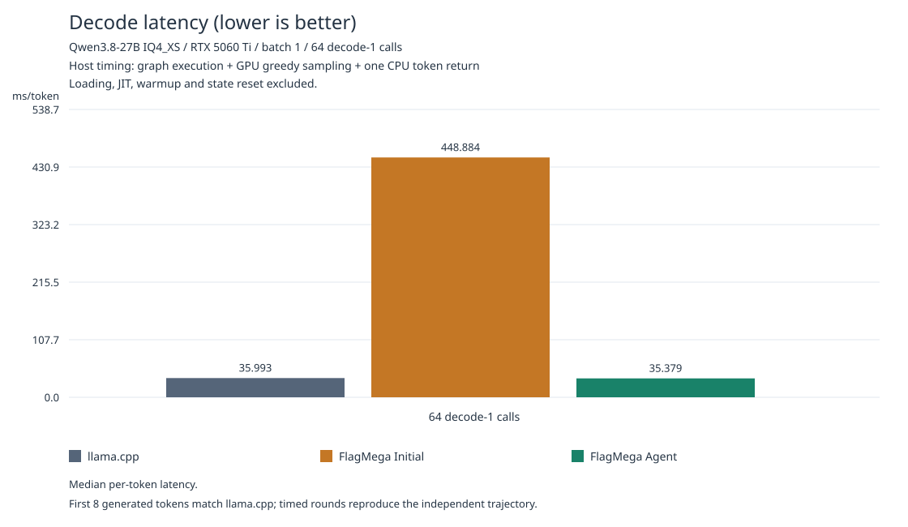
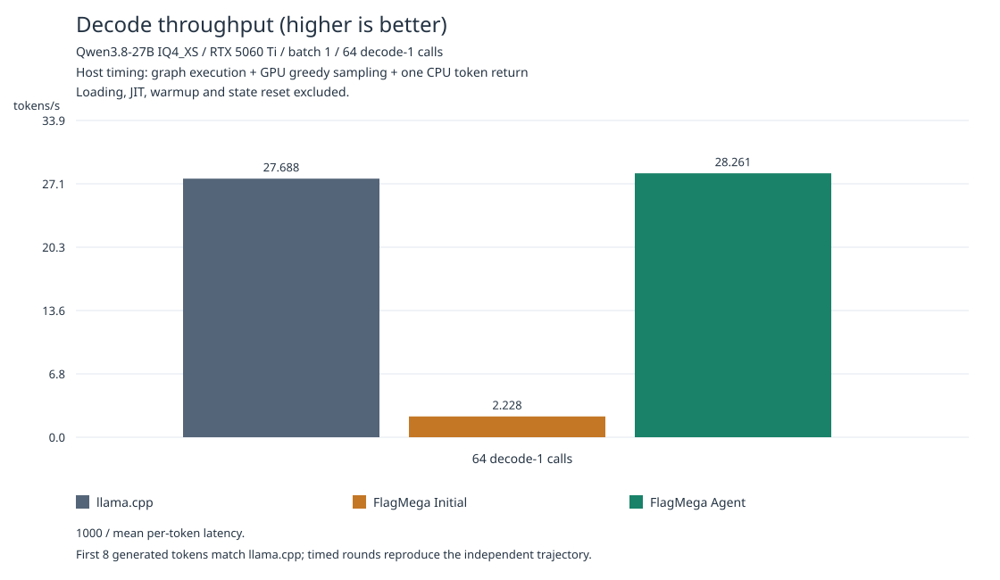

# Qwen3.8-27B IQ4_XS decode on RTX 5060 Ti

This tutorial imports an original GGUF, compiles all 64 text decoder layers with
the [FlagMega developer skill](../../../../../skills/flagmega-developer/SKILL.md),
and checks independent greedy generation against official llama.cpp. Original
IQ4_XS/Q4_K weights stay packed in IR, readonly data and GPU storage. Matrix and
embedding kernels consume the packed bytes directly; no dequantized weight
checkpoint is created.

The reproducible checkpoint is
[jpetrina/Qwen3.8-27B-IQ4_XS-pure-GGUF](https://huggingface.co/jpetrina/Qwen3.8-27B-IQ4_XS-pure-GGUF),
revision `5a285a6217024a96be7064d6caf0a06121630ee1`, file
`qwen3.8-27b-IQ4_XS-pure.gguf`, 14,534,384,640 bytes, SHA-256
`ea5a3c45d407f9b9e5d2c0d647f0ea600f486f6b86b92b56d0823ba073dae675`.
The original custom `Qwen3.8-27B-IQ4_XS-MTP-Q4_K.gguf` has no public download
in the [author's post](https://www.reddit.com/r/LocalLLM/comments/1voygm9/running_qwen3827b_dense_fully_on_a_single_rtx/);
the user authorized this similar IQ4_XS file. Native Q4_K kernels are covered by
the focused GPU tests. The measured file's main decoder weights are IQ4_XS.

The entry executes 48 GDN and 16 full-attention layers, the output head and GPU
greedy sampling. It uses the nncase BF16 intermediate profile, F32 recurrent
state and F32 logits. Speculative MTP execution and batched prefill are outside
this decode-1 entry.

## Accepted results

| Backend | ms/decode call | tokens/s |
| --- | ---: | ---: |
| Current FlagMega compiler baseline | 448.89 | 2.23 |
| Official llama.cpp | 36.12 | 27.69 |
| FlagMega native IQ4 p/c + TMA | **35.38** | **28.26** |

Chinese64, two independent processes per backend, six measured rounds total, rotated order: **85.87%** model weight bandwidth, **2.07%** faster throughput than llama.cpp. Synthetic32 also passes: **35.35 ms/call**, vs llama.cpp 36.24 ms/call. The complete megakernel uses 149 registers/thread, 97,516 shared bytes and zero spills. PTX contains 44 bulk TMA and 36 DP4A instructions.

Both correctness workloads independently generate their first **8 tokens**
after the initial input or prompt and match llama.cpp. Subsequent inputs come
from each backend's own greedy outputs. Logits remain finite; their numerical
errors are diagnostic and exact logits equality is not required. The Chinese
workload has 17 prompt tokens and 64 decode-1 calls, with its required prefix
beginning at step 16. The second workload starts from token ID 1 and executes
32 calls. Every repeat resets recurrent/KV state and checks the graph trajectory.

Performance uses host time around graph execution, GPU greedy sampling and one
CPU token return on both backends. Loading, device JIT, warmup, state reset,
prompt input injection and full-logit diagnostics are outside timing. llama.cpp
uses its CUDA graphs, flash attention, backend greedy sampler and BF16 KV cache;
its native intermediate computations are F32. It is the unmodified upstream
commit `4413a192410fad1f054e9216114087a3e01527a0`, on the same GGUF and GPU.

Model weight bandwidth is **13,611,666,080 bytes per decode call / latency**:
the entire output head, one embedding row and the decoder weights, excluding MTP.
Relative to the RTX 5060 Ti's
[448 GB/s specification](https://www.nvidia.com/en-us/geforce/graphics-cards/compare/),
50% requires less than 60.77 ms/call. This is effective model weight bandwidth.




The figures use the same bar-chart style as the other FlagMega tutorials.
Latency bars show the pooled median; throughput is 1000 / mean per-token
latency. Initial is the current default compiler, and Agent is native IQ4
p/c + TMA. The table above reports mean latency.

The accepted artifact, hashes and evidence are recorded in
[validation.json](validation.json) and [figures/summary.json](figures/summary.json).
Chinese iteration notes and all rejected trials remain in `.local/优化迭代.md`.

## Native IQ4 producer/consumer implementation

The importable `agent_optimizations` package is installed before normal
distribution, candidate selection, code generation and artifact verification.
Its explicit `pc_tma` path uses 8 consumer warps and 1 producer warp, with 12
physical warps on SM120. Bulk TMA copies original packed weight rows into two
shared-memory stages while consumers run LUT decoding and DP4A accumulation.
POT segments fit the row data into shared memory without padding a GGUF weight
tensor. GLU uses two Q8 activation components for the required token accuracy;
their interleaved temporary words/scales live in compiler-managed CTA scratch.

`--q8-vector-quant` quantizes four contiguous values per lane and batches 256
groups. GDN caches head projections and norms with proofs over every active
owner coordinate, preserving the original Q/K rounding and reduction order.
These choices are local to this model/workload/target. The current default
compiler remains independently buildable and is measured as the agent baseline.

## Reproduce from the original checkpoint

Run from the repository root in the FlagTree environment (validated with
PyTorch 2.8.0+cu128 and Triton 3.6.0):

```sh
export TUTORIAL="$PWD/python/tutorials/flagmega/03-qwen3.8-27b-iq4/nvidia-rtx5060ti"
export LOCAL="$TUTORIAL/.local"
export CHECKPOINT="$LOCAL/checkpoint/qwen3.8-27b-IQ4_XS-pure.gguf"
export TRITON_CACHE_DIR="$LOCAL/triton-cache"
export PYTHONPATH="$PWD/python${PYTHONPATH:+:$PYTHONPATH}"
python -m pip install -r "$TUTORIAL/requirements.txt"
python "$TUTORIAL/download_checkpoint.py" --output "$LOCAL/checkpoint"
python "$TUTORIAL/prepare_checkpoint.py" --input "$CHECKPOINT"

python "$TUTORIAL/compile.py" --checkpoint "$CHECKPOINT" \
  --trial "$LOCAL/trials/baseline-001"
python "$TUTORIAL/compile.py" --checkpoint "$CHECKPOINT" \
  --trial "$LOCAL/trials/optimized-001" --optimization pc_tma \
  --tile-n 32 --warps 8 --iq4-chunk 512 --grid 32 --gdn-value-tile 32 \
  --gdn-fast-head --gdn-uniform-norm --gdn-cache-heads --pc-segments \
  --q8-group-tile 256 --q8-vector-quant --pc-dual-all --pc-dense-dual \
  --pc-global-activation --pc-packed-activation --pc-down-chunk 4096 \
  --pc-precision-scope glu
```

Every trial imports editable Python IR, verifies/inspects it, compiles through
normal FlagMega and verifies the executable. It records compiler and override
fingerprints, commands, source snapshots and `compile,pass-ir,egraph-cost` dumps.
`--input` also accepts an editable complete function dump directory; resume
before the earliest stage affected by a change. Final acceptance uses a fresh
build from the original GGUF.

Build the pinned llama.cpp on a volume with enough space:

```sh
export LLAMA_SOURCE="$LOCAL/llama.cpp"
export LLAMA_BUILD="$LOCAL/llama-build"
git init "$LLAMA_SOURCE"
git -C "$LLAMA_SOURCE" remote add origin https://github.com/ggml-org/llama.cpp.git
git -C "$LLAMA_SOURCE" fetch --depth 1 origin 4413a192410fad1f054e9216114087a3e01527a0
git -C "$LLAMA_SOURCE" checkout --detach FETCH_HEAD
cmake -S "$LLAMA_SOURCE" -B "$LLAMA_BUILD" -DGGML_CUDA=ON \
  -DCMAKE_CUDA_ARCHITECTURES=120 -DCMAKE_BUILD_TYPE=Release -DGGML_NATIVE=OFF \
  -DLLAMA_BUILD_TESTS=OFF -DLLAMA_BUILD_EXAMPLES=OFF -DLLAMA_BUILD_COMMON=OFF
cmake --build "$LLAMA_BUILD" --target llama -j12

python "$TUTORIAL/llama_golden.py" --llama-source "$LLAMA_SOURCE" \
  --llama-build "$LLAMA_BUILD" --checkpoint "$CHECKPOINT" \
  --output "$LOCAL/llama-golden-chinese" --steps 64 \
  --prompt '请用中文解释为什么量化模型的单 token decode 通常受显存带宽限制。'
python "$TUTORIAL/llama_performance.py" --llama-source "$LLAMA_SOURCE" \
  --llama-build "$LLAMA_BUILD" --checkpoint "$CHECKPOINT" \
  --output "$LOCAL/llama-performance-chinese" --steps 64 --repeats 3 \
  --prompt '请用中文解释为什么量化模型的单 token decode 通常受显存带宽限制。'

python "$TUTORIAL/benchmark.py" --artifact "$LOCAL/trials/baseline-001/artifact" \
  --llama-reference "$LOCAL/llama-golden-chinese" --independent-generation \
  --golden-token-prefix 8 --steps 64 --repeats 3 --measurement host-token \
  --output "$LOCAL/baseline-chinese.json"
python "$TUTORIAL/benchmark.py" --artifact "$LOCAL/trials/optimized-001/artifact" \
  --optimization pc_tma --grid 32 --gdn-value-tile 32 \
  --gdn-fast-head --gdn-uniform-norm --gdn-cache-heads --pc-segments \
  --q8-group-tile 256 --q8-vector-quant --pc-dual-all --pc-dense-dual \
  --pc-global-activation --pc-packed-activation --pc-down-chunk 4096 \
  --pc-precision-scope glu --llama-reference "$LOCAL/llama-golden-chinese" \
  --independent-generation --golden-token-prefix 8 --steps 64 --repeats 3 \
  --measurement host-token --output "$LOCAL/optimized-chinese.json"
python "$TUTORIAL/render_results.py" --trial "$LOCAL/trials/optimized-001" \
  --benchmark "$LOCAL/optimized-chinese.json" \
  --llama-performance "$LOCAL/llama-performance-chinese" \
  --baseline-benchmark "$LOCAL/baseline-chinese.json"
```

For the second workload, create new golden/performance directories with
`--steps 32 --token-id 1` and no `--prompt`, then run the optimized benchmark
against that golden with `--steps 32`. Keep all GPU runs sequential and rotate
backend order when comparing repeated performance runs.

`llama_golden.py` exports full logits for diagnostics. `llama_performance.py`
measures the matched sampling/token-return boundary. Both record checkpoint,
upstream commit, runner and CMake fingerprints. Their roles are separate.

## Artifacts and checks

All generated work lives in the gitignored `.local/`: checkpoint, readonly-data
cache, immutable trials, compiler dumps, raw timings and iteration notes. Large
directories may be symlinked to a volume with enough space. Public reproduction
creates its own outputs and requires no private previous trial.

[generated_kernels.py](generated_kernels.py) is the accepted source snapshot.
Execution also requires its artifact IR, manifest and readonly data, produced
by `compile.py`. Existing trial/result paths are preserved; choose fresh names.

```sh
PYTHONPATH=python python -m pytest -q \
  python/test/flagmega/importer/test_gguf_checkpoint.py \
  python/test/flagmega/codegen/triton/test_gguf_native_quant.py
```

Reusable compiler fixes have causal core regressions and SM120 kernel checks.
Local Q8/GDN layout tests, failed candidates and their resource reports are
retained under `.local/`; publication uses the actual verified and measured
fresh artifact.
